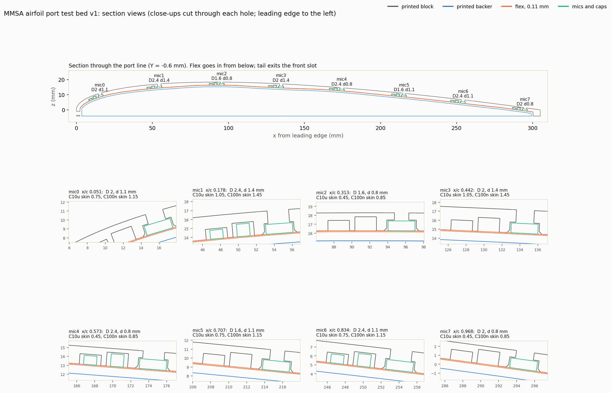

# Airfoil port test bed v1

> **Superseded for the next test by [`../airfoil_testbed_4415/`](../airfoil_testbed_4415/)** (2026-11-01). The NACA 0012 was the wrong profile; the next test uses the NACA 4415 wing file, with the flex angled across the chord.

One print that tests 8 mic-port geometries at once under a Monokote skin. It is a 30 mm wide slice of the NACA 0012 upper surface (304.8 mm chord, same as `Air Foil NACA 0012.step`) on a flat 4 mm base. The mic flex goes in from below, components up. Each mic presses into its own pocket under a hole of a different diameter **D** and depth **d** (d = skin over the mic lid = hole length). A backer bar prints in place inside the channel and later holds the flex up.

**The shape matches `Air Foil NACA 0012.step` (checked 2026-10-30).**
- **Equation:** the STEP uses the closed, sharp-trailing-edge NACA 0012 (x⁴ coefficient −0.1036), and so does this generator.
- **Section comparison:** the printed block's top surface is within 0.044 mm of the STEP's upper surface everywhere. The worst spot is the first 5 mm of the nose, and past that it's within 0.01 mm.
- **Overall size:** chord 0–304.8 mm, maximum half-thickness 18.29 mm at x = 91.4 mm, same as the STEP.
- **What's left out:** the STEP's two 3/8" mount holes in the root face, which the bench piece doesn't need.

## Files

| File | Use |
|---|---|
| `output/MMSA_testbed_v1_print.3mf` | **The print.** Block and backer on one plate, already diagonal and centered on the P1S bed. Don't re-arrange it |
| `output/MMSA_testbed_v1.step` | Block and backer as solids. Open in Fusion 360 (File > Open) to edit |
| `output/reference/MMSA_testbed_v1_backer_only.3mf` | Spare backer, if one is needed later |
| `output/reference/MMSA_testbed_v1_fitcheck.step` | Block and backer plus a dummy flex, mics and caps in place |
| `output/reference/testbed_design.json` | Every computed position and check |
| `generate_testbed.mjs` | Builds everything (`node generate_testbed.mjs`; `--dry` prints the layout only) |
| `preview_testbed.py` | Redraws the section image from the meshes |

The generator uses replicad (OpenCascade in Node). It's already installed under `ProjectTreebeard/MSV3/.../tools/node/node_modules`. Set `REPLICAD_NODE_MODULES` if it moves. Each build checks that:
- no mic, cap or flex overlaps the block or backer;
- the backer stays at least 0.35 mm from the block so it can print in place;
- the meshes are watertight;
- the plate fits the bed.

## Print

**Orientation: as laid out, base flat on the bed and top surface up.** This is the only orientation that needs no supports.
- The channel roof bridges 14.6 mm between the channel walls, the pocket roofs bridge 2–5 mm, and the holes are vertical.
- Every other orientation either needs supports under the curved top or turns the port holes sideways, where they print out of round.
- The backer prints flat on the bed inside the channel, with a 0.4 mm gap on all sides. It comes off the bed as a separate part.
- **The diagonal runs from back-left to front-right.** The P1S has a no-print zone in the front-left corner (x 0–18, y 0–28 mm, `bed_exclude_area` in its profile). The other diagonal put the leading edge on it, and Bambu Studio flagged it as too close to the exclusion area. Now the part is 134 mm from that zone and 9.6 mm from every bed edge. The generator checks both.
- **Standard 0.4 mm nozzle.** Nothing needs a smaller one. The smallest hole is 1.6 mm, the thinnest skin is 0.45 mm (set by layer height), and the thinnest wall is 0.6 mm between the two cap pockets, which may print as a single line.

Sliced with the command-line version of Bambu Studio (P1S 0.4 nozzle, Bambu PETG Basic, Textured PEI plate, **supports off**). No supports needed and no warnings:

| Settings | Filament | Time |
|---|---|---|
| 0.12 mm Fine, 15% grid (defaults) | 72 g | 3 h 11 min |
| **0.12 mm Fine, 10% lightning infill** (recommended) | **54 g** | **2 h 53 min** |
| 0.16 mm, 10% lightning infill | 58 g | 2 h 23 min |
| *Old 50 mm wide, 6 mm base design, defaults* | *112 g* | *4 h 24 min* |

- **Material:** PETG or ASA, not PLA, because Monokote irons on at about 105–120 °C.
- **Layers:** 0.12 mm keeps the hole depths (0.8 / 1.1 / 1.4 mm) to within about ±0.06 mm. 0.16 mm is faster, with about ±0.08 mm.
- **Lightning infill:** only builds up under top surfaces, which is all this part needs.
- **Brim:** Auto, which on this part means no brim. *Outer brim only* is also safe. A 0.6 mm sill across the bottom of the front tail slot makes the block's first layer a closed ring around the backer, so brim lines stay outside it; checked in the sliced G-code. Without the sill, a forced outer brim ran into the channel mouth and could have tied the backer to the block. Don't use an inner brim.
- **Elephant-foot compensation:** leave it at the default 0.15 mm. It keeps the 0.4 mm backer gap open on the first layer.
- **If your Bambu Studio warns about a "floating cantilever":** that's its heuristic reacting to the 14.6 mm curved channel roof, which is a normal bridge. Print with supports off anyway. The old 50 mm design triggered it, and so did an STL conversion of this one. The 3MF as shipped doesn't.
- **Holes:** after printing, check each with a drill bit of the nominal size (1.6 / 2.0 / 2.4 mm) and ream if undersize. FDM holes usually print 0.1–0.2 mm small.

## Port variants

**This bench piece runs the array straight along the chord. The real wing won't.** There the array is yawed about 15–20° across the chord so no port sits in an upstream port's wake. See "Wing build notes" in `reference/PORT_FILTER_PLAN.md`. The angle doesn't matter for port acoustics, but the x/c values below won't match the wing.

mic0 is the end nearest the FPC tail, so the tail sits at the leading edge and exits through a slot in the front face. Port positions come from `Flex Array_PCB.step`.

| Mic | x/c | D (mm) | d (mm) | Film loss guess, 30 / 60 / 120 N/m (dB) |
|---|---|---|---|---|
| 0 | 0.051 | 2.0 | 1.1 | 9 / 14 / 19 |
| 1 | 0.178 | 2.4 | 1.4 | 8 / 13 / 18 |
| 2 | 0.313 | 1.6 | 0.8 | 10 / 14 / 20 |
| 3 | 0.442 | 2.0 | 1.4 | 11 / 15 / 20 |
| 4 | 0.573 | 2.4 | 0.8 | 6 / 9 / 14 |
| 5 | 0.707 | 1.6 | 1.1 | 12 / 17 / 22 |
| 6 | 0.834 | 2.4 | 1.1 | 7 / 11 / 16 |
| 7 | 0.968 | 2.0 | 0.8 | 7 / 11 / 16 |

The guesses use the film-over-sealed-cavity model from `reference/PORT_FILTER_PLAN.md`, with the hole as the whole cavity. Real Monokote tension is unknown. The simple model says the loss depends only on d/D², so mic0, mic1 and mic2, which have similar d/D², should read within about 1–2 dB of each other. If they don't, the model is missing something (gasket gap, the mic's own front volume, film stiffness).

Notes:
- **Big holes are offset from the port.** The 2.0 and 2.4 mm holes are shifted up to 0.33 mm off the port, toward the package center, so the hole edge stays 0.35 mm inside the lid edge. The port is still fully under the hole. Along the chord a 2.4 mm hole leaves 0.3 mm of lid on each side.
- **The capacitors set the minimum depth.** Each mic's 10 µF cap is 0.3 mm taller than the mic, so the skin over it is d − 0.35 mm. The shallowest depth is therefore 0.8 mm, which keeps every cap pocket closed under at least 0.45 mm of skin. The top has no openings except the 8 ports. Going thinner needs lower-profile caps (0402) on the next flex revision.
- **The channel roof sits 0.1 mm above each mic lid for a tape gasket.** A small square of thin double-sided tape on each lid, with a hole about the size of the window punched over the port, seals the pocket. Without it the 0.1 mm air gap around the lid adds cavity volume.
- **Each mic pocket has a 0.3 mm 45° chamfer at its mouth** so the mics find their pockets.

## Assemble

Work with the block **upside down**, its top surface on a soft cloth, so gravity holds the flex in the channel.

1. Lift the block off the bed. The backer comes off separately.
2. Optional: tape gaskets on the mic lids (see above).
3. Lay the flex in the channel components-down, with the tail at the leading-edge end, and feed the tail out through the front slot. Press each mic into its pocket; the chamfers guide them in.
4. Put about 1 mm of foam mounting tape along the top of the backer and press it into the channel, foam side onto the flex. It sits flush with the base.
5. Turn the block upright. On a table the table holds the backer in. Put tape across the bottom if you'll be picking it up.

## Test

1. **Run A, no film:** record a speaker sweep or pink noise from a fixed position over the top.
2. Take the flex out, iron one Monokote sheet over the whole top, and refit the flex.
3. **Run B, with film:** same source, same position, same level.
4. B ÷ A per mic is the film loss for that port, because the mic, position and sound field are the same in both runs. A calibration script doesn't exist yet.

## Change something

Edit `P` (fits, sizes) or `VARIANTS` (D and d per mic) at the top of `generate_testbed.mjs` and re-run it, then `python preview_testbed.py`. The build fails if a change makes parts collide, crowds the backer, puts the strip past either edge, or doesn't fit the bed.
