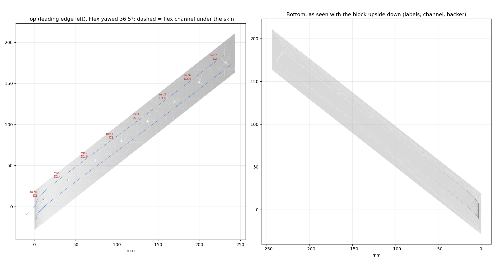

# Airfoil port test bed, NACA 4415

This rig replaces [v1](../airfoil_testbed/) for the next port test. v1 was cut from the NACA 0012, which turned out to be the wrong profile (2026-11-01). The job is the same: one print tests 8 mic-port geometries under a Monokote skin. Each mic sits in its own pocket under a hole of a different diameter **D** and depth **d** (d = skin over the mic lid). The flex, port variants, fits and backer are all the same as v1.

**What changed:**
- **The surface comes from the wing file.** It is the upper surface of `input/Air Foil NACA 4415 Small Slot.step` (243.84 mm chord, LE at x = 60.96 in the STEP), sampled straight from the file. The printed top is within 0.03 mm of the STEP everywhere checked, about 4,800 points across the whole chord.
- **The flex runs at 36.5° across the chord.** This airfoil's upper surface is only 260 mm long, too short for the 300 mm flex laid straight. 36.5° is the smallest angle (in 0.5° steps) that fits with the same end margins as v1, and the real wing has to angle the array anyway.
- **The block is a straight diagonal slice of the wing**, 37.4 mm wide, at 38.2° to the chord in plan, on a flat 4 mm base. A straight strip laid at an angle over the rounded nose curves in plan view, so the channel inside bends near the leading edge. The outer walls stay straight anyway, so the side walls are at least 7.7 mm thick (as in v1) and thicker near the nose. The first build (2026-11-02, early morning) had walls that followed the channel and hooked round at the nose.

**Heads-up on the profile:** the STEP's section is about 20% thick (48.7 mm on the 243.8 mm chord). A true NACA 4415 is 15% (36.6 mm). This rig copies the file either way. Check the wing file before printing the wing.

## Files

| File | Use |
|---|---|
| `output/MMSA_testbed_4415_print.3mf` | **The print.** Block and backer on one plate, already placed on the P1S bed. Don't re-arrange it |
| `output/MMSA_testbed_4415.step` | Block and backer as solids. Open in Fusion 360 to edit |
| `output/reference/MMSA_testbed_4415_backer_only.3mf` | Spare backer |
| `output/reference/MMSA_testbed_4415_fitcheck.step` | Block and backer plus a dummy flex, mics and caps in place |
| `output/reference/testbed_ports.png` | A cut along the flex through every hole |
| `output/reference/testbed_design.json` | Every computed position and check |
| `generate_testbed_4415.mjs` | Builds everything (`node generate_testbed_4415.mjs`; `--dry` prints the layout only; `--yaw=40` forces an angle). About 4 minutes |
| `preview_testbed_4415.py` | Redraws the two PNGs from the meshes |

Each build checks that:
- no mic, cap or flex overlaps the block or backer (all 0);
- the backer stays at least 0.35 mm from the block so it can print in place (0.40 mm);
- the meshes are watertight;
- the plate clears the bed edges and the front-left no-print zone (6.7 mm and 130 mm).

## Print

**Orientation: as laid out, base flat on the bed.** That's the only orientation that needs no supports, same as v1. The plate is 242 × 243 × 38 mm.

Sliced with the command-line version of Bambu Studio (P1S 0.4 nozzle, Bambu PETG Basic, Textured PEI, **supports off**, brim auto): **0.12 mm Fine, 10% lightning infill: 76 g, 3 h 16 min, no warnings.**

The v1 print notes all still apply:
- PETG or ASA, not PLA.
- No inner brim.
- Elephant-foot compensation at 0.15 mm.
- Ream each hole with a drill bit of the nominal size (1.6 / 2.0 / 2.4 mm).

The holes are 48-sided prisms rather than true cylinders, which is 0.003 mm from round. A true cylinder made a bad mesh at mic6.

## Ports

mic0 is at the tail end, so the tail exits through an 18 mm wide slot in the front face, 0.6 mm above the bed.

| Mic | x/c | Surface slope (°) | D (mm) | d (mm) | Skin over 10 µF / 100 nF cap (mm) |
|---|---|---|---|---|---|
| 0 | 0.047 | 35 | 2.0 | 1.1 | 0.75 / 1.15 |
| 1 | 0.168 | 14 | 2.4 | 1.4 | 1.05 / 1.45 |
| 2 | 0.303 | 3 | 1.6 | 0.8 | 0.45 / 0.85 |
| 3 | 0.433 | −5 | 2.0 | 1.4 | 1.05 / 1.45 |
| 4 | 0.564 | −9 | 2.4 | 0.8 | 0.45 / 0.85 |
| 5 | 0.698 | −13 | 1.6 | 1.1 | 0.75 / 1.15 |
| 6 | 0.822 | −16 | 2.4 | 1.1 | 0.75 / 1.15 |
| 7 | 0.952 | −19 | 2.0 | 0.8 | 0.45 / 0.85 |

Film-loss guesses depend only on D and d, so they're the same as v1's table.

**Labels:** each label (e.g. `3: D2.0 d1.4`) is engraved 0.4 mm into the bottom face next to its mic. They read correctly with the block upside down, which is how it's assembled.

**Roof depth:** it changes with chord position only, flat over each mic's pockets and blended between mics. So the flex lies on a surface that unrolls flat, at a constant angle, without stretching. Where the depth ramps, the roof is up to about 0.6 mm higher on one edge of the flex than the other. The flex follows that easily.

## Assemble and test

Same as v1; see [../airfoil_testbed/README.md](../airfoil_testbed/README.md) ("Assemble" and "Test").
- Work with the block upside down on a cloth.
- Lay the flex components-down with the tail at the leading-edge end, and feed the tail out of the front slot.
- Press each mic into its pocket.
- Put foam tape on the backer and press it in.
- Run A without film, then Run B with film. B ÷ A per mic is the film loss for that port.

## Change something

Edit `P` or `VARIANTS` at the top of `generate_testbed_4415.mjs`, re-run it, then run `python preview_testbed_4415.py`. The build fails if parts collide, the backer gets too close to the block, the flex doesn't fit on the surface, or the plate doesn't fit the bed. Point `AIRFOIL_STEP` at another wing file to rebuild on a different profile. It needs an upper B-spline face whose leading and trailing edges sit on z = 0.
