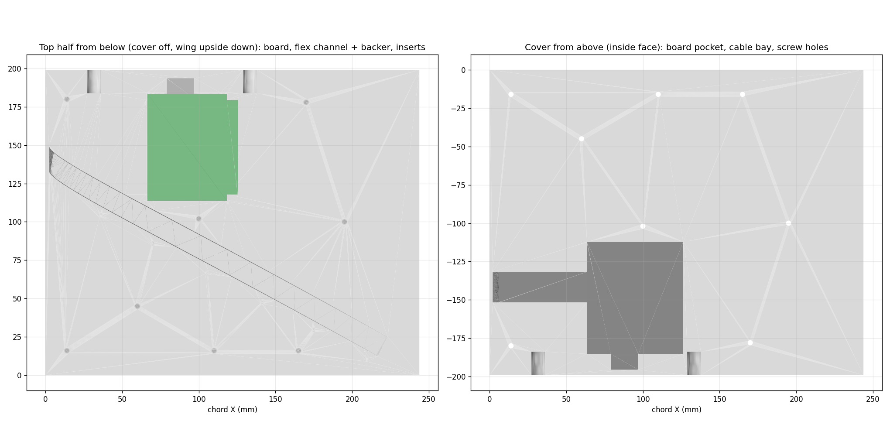
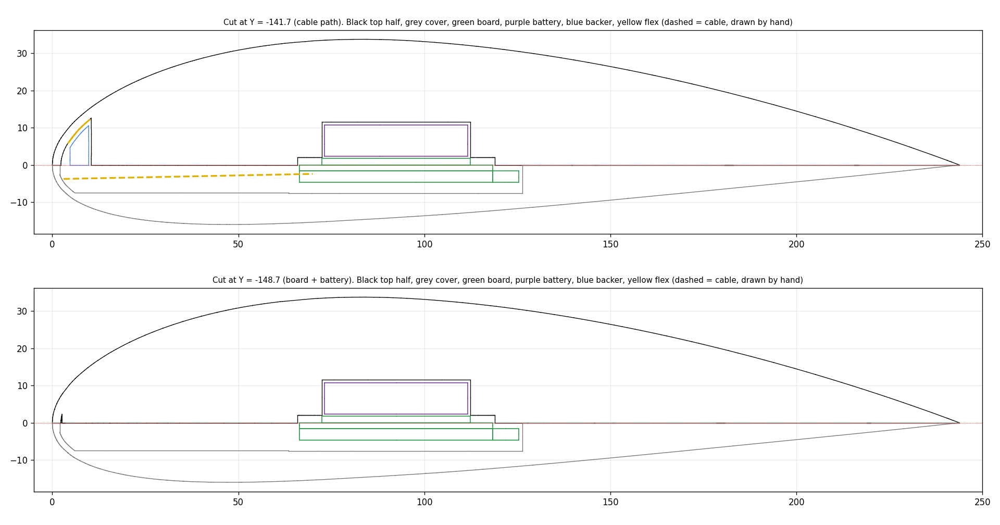

# NACA 4415 wing with the mic array, board and battery inside

The full wing for the wind tunnel, printed on the P1S in two halves. Outside, it is the airfoil from `../airfoil_testbed_4415/input/Air Foil NACA 4415 Small Slot.step`: 243.84 mm chord and 199.14 mm span, with the two Ø8.9 mm mounting holes in the root face. Everything inside was redone from scratch. The old bottom bay, skin slot and bosses are gone.

Inside it holds:
- the mic flex, under the upper skin at an angle across the chord (yaw);
- the MMSA V2 board;
- the 2000 mAh battery (PKCELL LP803860).

Take the cover off and you can reach USB-C, the SD card, the buttons and the flex connector. Nothing has to come out to charge or swap the card. The board, the battery and the flex can all still come out.

> **Status (2026-11-02):** built and checked by the script, not printed yet. Two inputs are still estimates: the board dimensions and the port size. See "Before printing".

## How it goes together

- **Split:** at the chord line (Z = 0). The leading and trailing edges both sit on it, so each half prints flat-side down with no supports on the outside.
- **Top half:** carries the flex channel, the mic pockets and ports, the board, the battery and M3 heat-set inserts.
  - The board mounts **components facing down** on the half's flat inside face, on four M2.5 heat-set inserts in its corner holes.
  - The battery is taped into a pocket directly above the board. Its wires come down past the board's battery-connector end to the plug.
- **Cover:** the bottom half. It has a pocket for the board's parts, a bay for the flex cable, and countersunk M3 screws that sit flush with the lower surface. Monokote goes over everything, seam included.
- **Flex:** **mic0 is left unpopulated.** The strip lies under the upper skin from near the leading edge at the root to near the trailing edge at the tip. Past mic1 it wraps round the nose into the cover and runs straight back to the board's connector. mic0's 44 mm of strip plus the 46 mm tail make the cable, so there's no extension. After the nose the strip is upside down, which is why the board is upside down too.
- **Backer:** prints in place inside the flex channel, as on the test bed. With foam tape on it, the closed cover presses it up so it holds the flex against the skin.

## Before printing

1. **Measure the board.** Its size, hole positions and connector positions in `P.board` were scaled from the 3D render (`docs/images/mmsa_v2_pcb_3d.png`), using the 18 × 25.5 mm ESP32 module as the scale. Check these with calipers:
   - the outline (51.8 × 69.8);
   - the hole inset (2.2 from each edge) and hole size (M2.5?);
   - the FPC connector centre (41.9 mm from the battery-connector end);
   - the battery connector (21.5 mm from the FPC edge).
2. **Pick the port.** `P.port` is a placeholder, D 2.0 / d 1.1. Use the winner from the port test bed.
3. Re-run `node generate_wing_4415.mjs` and `python preview_wing_4415.py`.

## Files

| File | Use |
|---|---|
| `output/MMSA_wing_4415_top_print.3mf` | **Print 1.** Top half and backer (printed in place), already on the P1S bed |
| `output/MMSA_wing_4415_cover_print.3mf` | **Print 2.** Cover, flat face down |
| `output/MMSA_wing_4415.step` | All three parts, to open in Fusion 360 |
| `output/reference/MMSA_wing_4415_fitcheck.step` | The parts plus dummy flex, mics, caps, board and battery |
| `output/reference/wing_*.png` | Plan, sections and port cuts |
| `output/reference/wing_design.json` | Every computed position and check |
| `generate_wing_4415.mjs` | Builds everything, about 5 minutes. `--dry` prints the layout only; `--yaw=30` sets the angle |
| `preview_wing_4415.py` | Redraws the PNGs |

Each build checks that:
- no mic, cap, flex, board or battery overlaps the top half, the cover or the backer (all 0);
- the backer stays at least 0.35 mm from the top half, so it can print in place (it is 0.38 mm);
- the meshes are watertight;
- both plates clear the bed edges (6.1 mm) and the front-left no-print zone.

## Print

Both halves print **flat side down, as laid out in the 3MFs**. Each fills a plate, at 243.8 × 199.1 mm. Sliced with the command-line version of Bambu Studio (P1S, 0.4 nozzle, Bambu PETG Basic, Textured PEI, 0.20 mm layers, 3 walls, 15% gyroid, **supports off**), with no warnings:

| Plate | Filament | Time |
|---|---|---|
| Top half + backer | 362 g | 10 h 52 min |
| Cover | 200 g | 6 h 06 min |

- Use PETG or ASA, not PLA. The Monokote iron is hot.
- The inside of the cover's board pocket is a roughly 60 mm bridge that doesn't show from outside. If it sags onto the board's parts, reprint the cover with supports set to "on build plate only".
- Ream each port with a drill bit of the nominal size, as on the test bed.

**Hardware:**
- Board: 4 × M2.5 heat-set inserts (Ø3.6 hole, 5 mm deep) and 4 × M2.5 × 6 screws.
- Cover: 8 × M3 heat-set inserts (Ø4.0 hole, 6 mm deep) and M3 countersunk screws, sized to the cover thickness at each spot (`layout.coverScrewLengths` in `wing_design.json`):
  - 4 × 20 mm
  - 1 × 25 mm
  - 1 × 16 mm
  - 1 × 12 mm
  - 1 × 10 mm
- Foam tape about 1.2–1.5 mm thick for the backer.
- Thin double-sided tape for the mic lids and the battery.

## Mics

mic0 is not fitted. The surface slope is positive where it rises toward the trailing edge.

| Mic | x/c | Surface slope (°) |
|---|---|---|
| 1 | 0.033 | 40 |
| 2 | 0.171 | 14 |
| 3 | 0.312 | 2 |
| 4 | 0.458 | −6 |
| 5 | 0.606 | −11 |
| 6 | 0.744 | −14 |
| 7 | 0.888 | −18 |

The flex runs at 28°. Each port is offset about 19 mm in span from the one before, so no port sits in the turbulent wedge (about ±11°) of the port upstream. This layout works from 28° to 30° (`--yaw=30` to try it):
- Below 28°, the board has to move back into the rear mounting hole in the root face.
- Above 30°, the strip runs out of span.

## Assemble

Work with the top half upside down on a cloth.

1. Press the heat-set inserts in: 4 × M2.5 for the board and the M3 inserts for the cover.
2. Lay the flex in the channel components-down, mic1 at the nose, and press each mic into its pocket (thin double-sided tape on the lids, as on the test bed). Let mic0's stretch of strip wrap round the nose and run back along the cable bay.
3. Tape the battery into its pocket with its wire end toward the root, and lead the wires out through the slot.
4. Fit the flex tail into the board's FPC connector and screw the board down, components facing you. Plug in the battery.
5. Put foam tape (about 1.2–1.5 mm) on the backer and press it into the channel.
6. Screw the cover on, then put the Monokote on.

To charge or read the SD card: take the Monokote off, then the cover.

## Change something

Edit `P` at the top of `generate_wing_4415.mjs`:
- **`yawDeg`:** 28–30° with this board position.
- **`port`:** hole diameter D and skin depth d.
- **`board` and `battery`:** sizes.
- **`coverScrewCandidates`:** cover screw positions.

The build stops if:
- parts collide;
- the backer would print too close to the top half;
- the flex doesn't fit or can't reach the board;
- a screw has nowhere safe to go;
- a part doesn't fit the bed.
