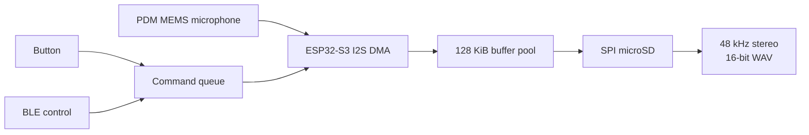

# ESP32-S3 PDM Audio Recorder

[](https://github.com/samam624/esp32-s3-pdm-audio-recorder/actions/workflows/portfolio-checks.yml)

ESP32-S3 firmware for a custom PCB carrying a PDM MEMS microphone and a
microSD card slot. The goal: record audio to the SD card, triggerable by a
physical button and (working, as of 2026-07-07) Bluetooth LE.

**Sam's role:** designed the recorder carrier hardware, specified capture and control behavior,
and validated the prototype on the bench. Firmware implementation was AI-assisted and tested
against the physical board and recorded WAV files.

> [!IMPORTANT]
> This repository is the capture prototype: one PDM front end and an external SPI microSD module.
> It validates 48 kHz stereo, 16-bit WAV capture, DMA, BLE/button control and 128 KiB buffering. It
> does not demonstrate the separate eight-microphone flex array's full multi-channel recording path
> or the integrated controller's SD/BLE paths.

## Status

**Working.** [ESP32_S3_SD_Recorder](ESP32_S3_SD_Recorder/) is the active
firmware — flashed and validated on the bench hardware (last 2026-10-01). Everything
else in this repo is earlier exploratory/diagnostic work kept for reference.

## 30-second engineering summary



| Evidence | Bench result |
|---|---|
| Capture format | 48 kHz stereo, 16-bit PCM WAV |
| Storage resilience | Producer/consumer buffering isolates PDM capture from variable SD write latency |
| Hot-insert recovery | Four pull/reinsert trials upgraded 8/16/16/10 MHz mounts to 20 MHz; all four recordings reported zero dropped audio |
| Timing check | [`bench_tests/REC_00002.WAV`](bench_tests/REC_00002.WAV) contains 1/2/3 kHz test tones placed at 1/3/5 seconds |
| Controls | Physical button and BLE start/stop both bench-validated |

The detailed [active-firmware README](ESP32_S3_SD_Recorder/README.md) records the buffering,
card-remount and failure-recovery behavior. Sample recordings are retained as measurement
artifacts rather than as a claim about the separate eight-microphone system.

## Directory map

| Path | What it is |
|---|---|
| [ESP32_S3_SD_Recorder/](ESP32_S3_SD_Recorder/) | **Current firmware.** Records PDM mic audio to WAV files on the SD card. Button or BLE triggered. See its own README for full details. |
| [ESP32_S3_USB_Mic/](ESP32_S3_USB_Mic/) | Earlier firmware that exposes the PDM mic as a USB Audio Class (UAC) microphone over native USB, instead of recording to SD. Superseded by the SD recorder for this project's goals, but useful if you need the ESP32 to show up as a Windows recording device again. |
| [SD_Card_SPI_Diagnostic/](SD_Card_SPI_Diagnostic/) | Standalone diagnostic sketch used to bring up and debug the SD card over SPI on this PCB (raw SPI probing, low-level SD command probing, mount-speed sweep). This is what validated the SD wiring on 2026-07-07 before the recorder was built. Re-run this first if the SD card ever stops mounting. |
| [ESP32_devkit_Mems_Test_2.ino](ESP32_devkit_Mems_Test_2.ino) | Earliest PDM mic test: streams raw PCM over Serial (921600 baud) between `REC_START`/`REC_STOP` markers, no SD card involved. Paired with `mictest.py`. |
| [mictest.py](mictest.py) | Python/pyserial companion script for `ESP32_devkit_Mems_Test_2.ino` — waits for the button-press marker, captures raw PCM over serial, writes it to a WAV file on the PC. Not used by the current SD-recorder firmware (which needs no PC in the loop). |
| `button_recording.wav`, `esp32_pdm_test.wav` | Sample recordings captured during early bring-up/testing. |
| [damping_tests/](damping_tests/) | Damping test recordings `REC_00007`–`REC_00034` copied off the SD card, with `SHA256SUMS.txt` of the originals. Timestamps on these are 1980 (no clock was set when they were recorded). |
| [bench_tests/](bench_tests/) | 2026-10-01 bench recordings used to verify capture speed: `REC_00002.WAV` has 1/2/3kHz test tones at 1s/3s/5s. |
| [SD_Card_testing.ino](SD_Card_testing.ino) | Very first basic SPI SD test (from the original GitHub upload); superseded by `SD_Card_SPI_Diagnostic/`. |
| [070926 Data/](070926%20Data/) | Analysis of the 070926 microphone-covering (damping) screening test: test-label spreadsheet, per-take WAVs (same recordings as `damping_tests/`), `full_spectrum_attenuation.py` and `audio_level_audit.js`, metrics CSVs, figures, and an interactive HTML report. Paper notes are in `UNDERGRAD_PAPER_TAKEAWAYS.md`. |
| [070926_Mic_Damping_Paper_Package/](070926_Mic_Damping_Paper_Package/) | Curated figures, tables, source spreadsheet and report for the damping write-up. Start with `00_READ_ME_FIRST.md`. The `.zip` beside it is the same package. |
| [presentation/](presentation/) | Project presentation draft (`.pptx`), its outline (`PRESENTATION_DRAFT.md`), and `build_deck.js`, which generates the deck with pptxgenjs. |

## Hardware (custom ESP32-S3 PCB)

Confirmed pinout, shared across the sketches above:

| Signal | GPIO |
|---|---|
| PDM mic clock | 4 |
| PDM mic data | 5 |
| Record button | 35 |
| REC LED | 40 |
| Level-meter LED | 41 |
| SD status LED | 42 |
| SD SPI SCK | 12 |
| SD SPI MOSI | 13 |
| SD SPI MISO | 11 |
| SD SPI CS | 14 |

There is **no dedicated SD card-detect (CD) pin** wired on this board revision
(the SD socket was jury-rigged) — card presence is inferred in software. See
the SD recorder's README for how.

Chip: ESP32-S3 (QFN56, rev v0.2), 8MB embedded PSRAM, native USB (shows up as
`ESP32 Family Device` for flashing). Board profile in Arduino: **ESP32S3 Dev
Module**.

## Build/flash quickstart

All current work is built and flashed via `arduino-cli` (the copy bundled
with Arduino IDE 2 works fine and doesn't require a separate install):

```
"C:\Program Files\Arduino IDE\resources\app\lib\backend\resources\arduino-cli.exe"
```

See [ESP32_S3_SD_Recorder/README.md](ESP32_S3_SD_Recorder/README.md) for the
exact FQBN/board options and commands — they matter here because `CDCOnBoot`
has to be `cdc` for `Serial` output to show up on the native USB port, and the
board needs `PartitionScheme=huge_app` for the BLE stack to fit alongside the
audio buffer pool.

**Gotcha:** if `arduino-cli upload` fails with "port busy / Access is denied"
on Windows, it's usually the Arduino IDE's own background `arduino-cli daemon`
process holding the Serial Monitor connection open — not the IDE window
itself. Find and stop that specific process (`Get-CimInstance Win32_Process
-Filter "Name='arduino-cli.exe'"` in PowerShell) rather than closing the IDE.
