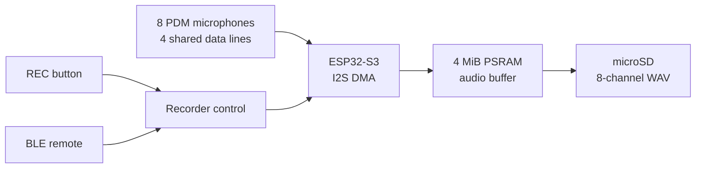

# MMSA V2 — Eight-Channel MEMS Microphone Array Recorder

MMSA V2 is a portable, battery-powered acoustic recorder built around an ESP32-S3 and a linear array of eight ST IMP34DT05 PDM microphones. It records synchronized multichannel audio directly to a microSD card and supports local button control or Bluetooth Low Energy (BLE) control. The system is being developed for wind-tunnel measurements, including evaluation of microphone wind-noise treatments on a wing.

> [!NOTE]
> The complete eight-channel system has been validated on the bench. Controlled wind-tunnel testing and acoustic calibration are the next stage; this repository does not yet claim calibrated pressure measurements or validated aerodynamic results.

## Current status

As of October 24, 2026, two MMSA V2 boards are assembled and running the same recorder firmware. All eight channels capture audio, the recording path uses PSRAM to absorb SD-card latency, and the physical REC buttons have been moved from GPIO 35 to GPIO 21 so that octal PSRAM can remain enabled.

| Capability | Bench-validated result |
|---|---|
| Audio capture | 8 channels, 48 kHz, 16-bit PCM WAV (768 kB/s) |
| Microphone array | 8 microphones on four stereo PDM data lines; approximately 39.5 mm measured pitch |
| Storage | 20 MHz SPI microSD; approximately 1.47–1.50 MB/s sustained average in recorder tests |
| Buffering | 4 MiB PSRAM pool, providing approximately 5.5 s of SD-stall tolerance |
| Recording integrity | Three 300 s trials completed with no DMA overflows or dropped audio after PSRAM buffering was enabled |
| File resilience | One folder per take, continuous 30-minute file segmentation, and WAV-header checkpoints every 10 s |
| Controls | Button and BLE start/stop; BLE can be switched while recording |
| Analysis | Channel splitting, level/noise checks, interactive timelines, and acoustic source tracking |

The detailed [MMSA V2 firmware notes](MMSA%20V2/firmware/MMSA_V2_Recorder_BLE/README.md) contain the build settings, controls, test history, and known issues.

## System architecture

The microphone reader and SD writer are separated so that short storage stalls do not interrupt sampling. Each recording is stored as a numbered take containing sequential WAV files, which avoids FAT32 and WAV file-size limits while preserving a continuous acquisition.

## Using the recorder

1. Build and flash [`MMSA_V2_Recorder_BLE`](MMSA%20V2/firmware/MMSA_V2_Recorder_BLE/) using the exact ESP32-S3 board options and linker flags in its README.
2. Insert a FAT32 microSD card and wait for the record-ready LED on GPIO 40.
3. Short-press **REC** to start or stop a take; hold **REC** for one second to enable or disable BLE.
4. For remote operation, open [`ble_control.html`](MMSA%20V2/firmware/MMSA_V2_Recorder_BLE/ble_control.html) in a Web Bluetooth-capable browser and connect to **MMSA V2**.
5. Copy the take folder from the SD card and use [`split_wav.py`](MMSA%20V2/tools/split_wav.py) before listening to individual microphones; normal media players may incorrectly downmix the eight-channel file as 7.1 surround audio.

## Repository guide

| Path | Contents |
|---|---|
| [`MMSA V2/firmware/MMSA_V2_Recorder_BLE/`](MMSA%20V2/firmware/MMSA_V2_Recorder_BLE/) | **Current eight-channel recorder firmware**, BLE control page, build instructions, and operational notes |
| [`MMSA V2/bringup/`](MMSA%20V2/bringup/) | Hardware diagnostics and staged bring-up sketches for the integrated board and flex array |
| [`MMSA V2/reference/`](MMSA%20V2/reference/) | Pin/net documentation, component notes, saved schematic views, and manufacturer datasheets |
| [`MMSA V2/tools/`](MMSA%20V2/tools/) | Python tools for recorder stress tests, SD-card verification, WAV analysis, visualization, and source tracking |
| [`MMSA V2/data/`](MMSA%20V2/data/) | Selected measurement artifacts and interactive visualization examples |
| [`ESP32_S3_SD_Recorder/`](ESP32_S3_SD_Recorder/) | Earlier stereo development platform used to validate SD recording, buffering, controls, and recovery behavior |
| [`ESP32_S3_USB_Mic/`](ESP32_S3_USB_Mic/) | Earlier USB Audio Class microphone firmware |
| [`damping_tests/`](damping_tests/) and [`070926 Data/`](070926%20Data/) | Preliminary microphone-covering recordings and attenuation analysis |
| [`presentation/`](presentation/) | Editable project presentation source and generated slide deck |

## Known limitations and next steps

- The recorder is bench-tested but has not yet been characterized in the wind tunnel.
- The microSD card occasionally pauses for several seconds during long writes. The PSRAM buffer has absorbed the observed pauses, but the underlying card/FAT latency is still being investigated.
- An SD card may take approximately 8–12 seconds to remount after a reset performed immediately after recording; recording should begin only after the ready LED illuminates.
- Microphone sensitivity, phase matching, array geometry, and wind-noise treatments still require a controlled and repeatable calibration procedure.

The next planned experiment is a wind-tunnel comparison of uncovered microphones against selected microphones fitted with pop-filter material, using matched tunnel speeds, recording durations, and repeated trials.

## Project ownership

Sam designed the recorder hardware and flex-array system, defined the capture and control requirements, assembled and reworked the prototypes, and performed the bench validation. Firmware and documentation development were AI-assisted and checked against the physical hardware and recorded data.
